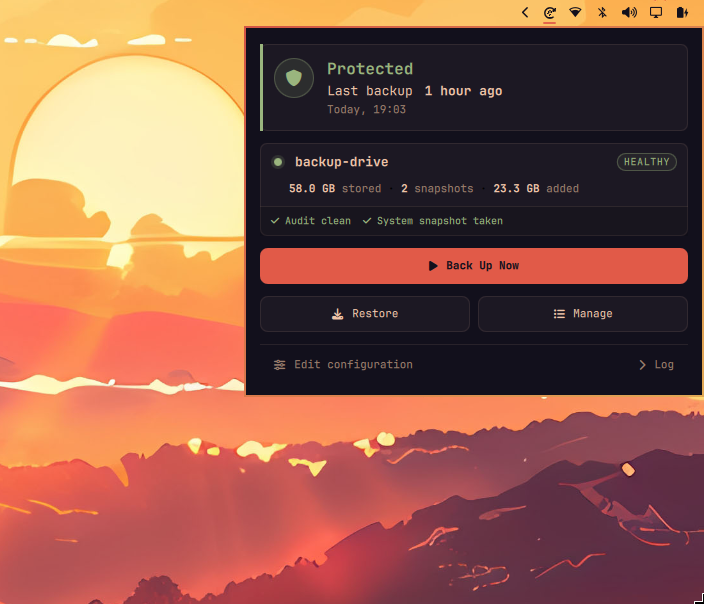
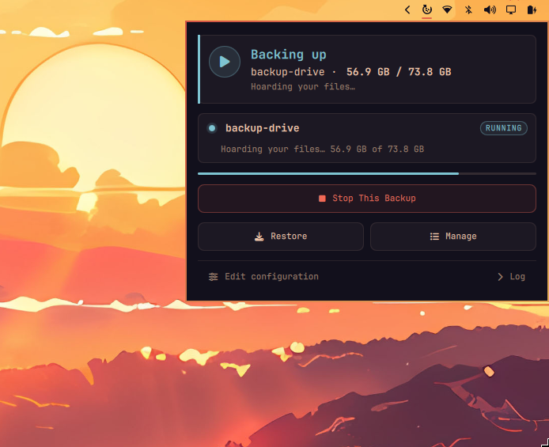
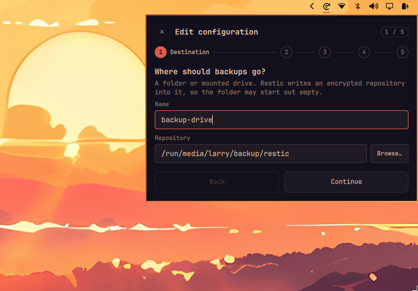
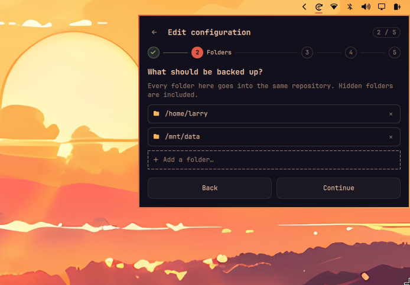
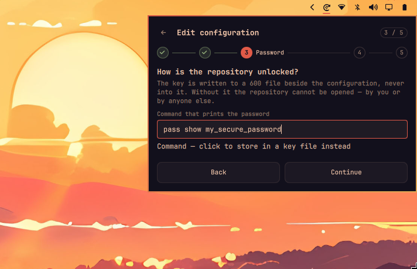
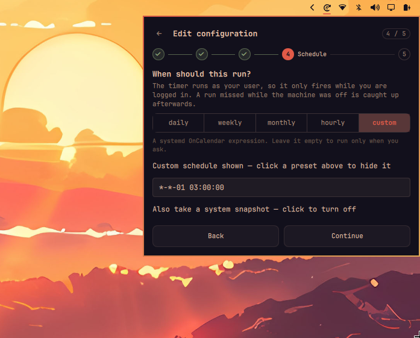
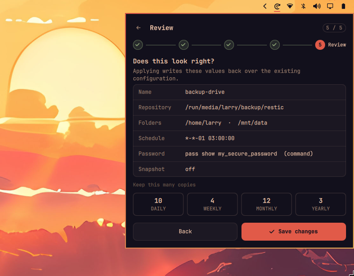
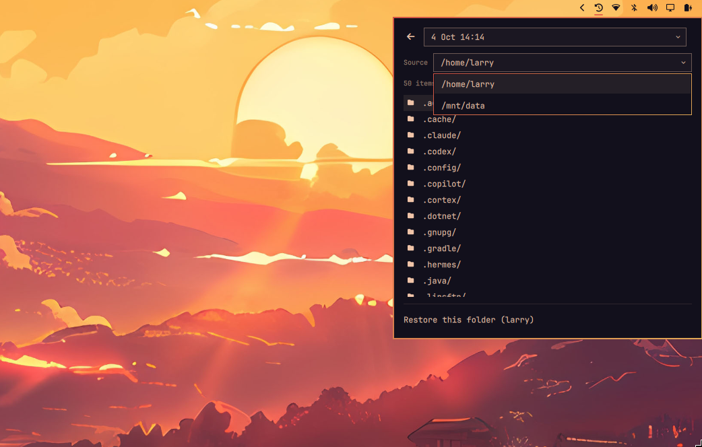
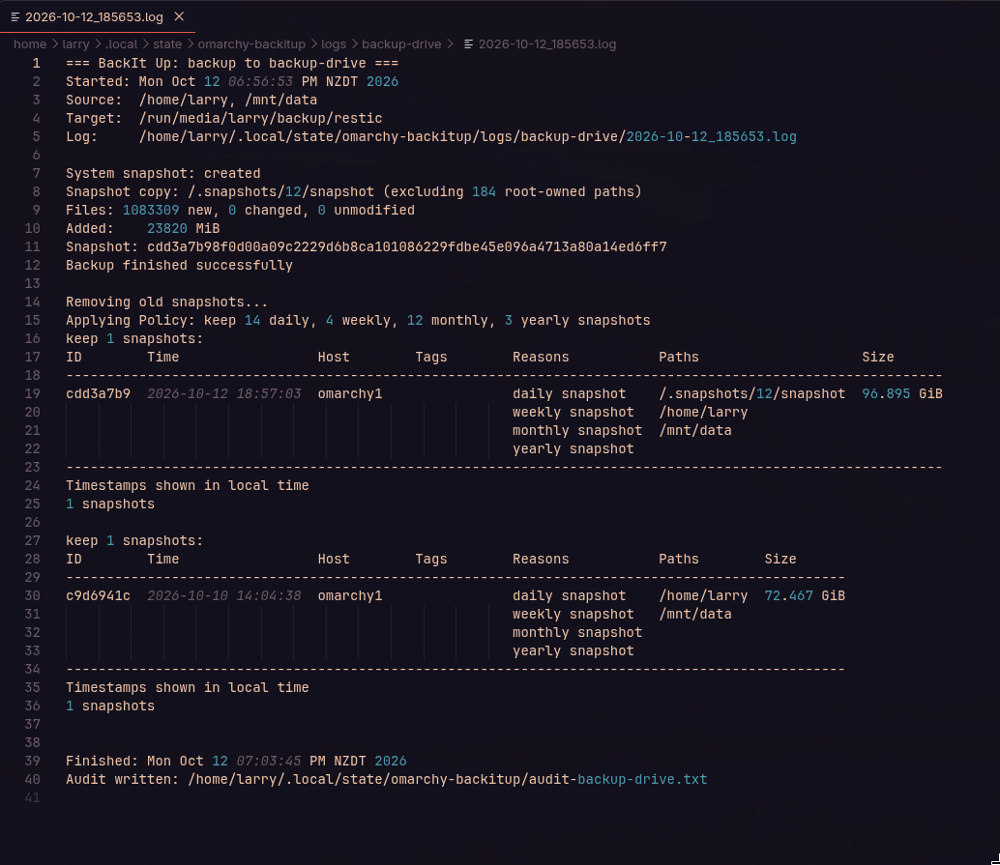

# BackIt Up

BackIt Up is a backup plugin for Omarchy. It uses [restic](https://restic.net) to copy your folders to a destination you choose, on a schedule you choose, and it shows one icon in your bar. The glyph stays still when the latest backup is healthy and rotates while a backup runs; when the latest backup failed it turns red and wears a small `!` badge, so you never have to open anything to know whether your backups are working. A destination that is merely not connected -- an unplugged drive -- does not turn it red; see [Destinations that are not always available](#destinations-that-are-not-always-available). It is drawn in the shell's own contrast colour, so it stays legible on a transparent bar over any wallpaper.

Backups are kept according to a retention schedule: by default 7 daily, 4 weekly, 12 monthly, and 3 yearly snapshots, with older ones pruned automatically. Files can be restored from a backup, and a backup can be deleted by hand from the panel, one at a time. Each backup can also take a system snapshot: a bootable rollback point that appears in the boot menu, taken at the moment the backup runs. It is optional, and needs a one-time sudoers line; see [System snapshots](#system-snapshots).




## Install

```bash
sudo pacman -S restic
omarchy plugin add https://github.com/larrynz/omarchy-backitup
omarchy plugin enable larrynz.backitup
omarchy bar move larrynz.backitup --section right
```

restic is the only dependency to install: the CLI also needs jq, but Omarchy ships that already.

### The command line

Some tasks are easier from a terminal. The plugin's command is not installed on your `PATH`; it lives inside the plugin directory:

```bash
~/.config/omarchy/plugins/larrynz.backitup/bin/omarchy-backitup
```

Every `omarchy-backitup ...` example below refers to that path. To type it comfortably, add an alias to your `~/.bashrc`:

```bash
alias omarchy-backitup=~/.config/omarchy/plugins/larrynz.backitup/bin/omarchy-backitup
```

## Setting up backups

Click the icon and choose **Set Up Backups**. A five-step wizard asks one question per screen, and nothing is written until the last one:

1. **Destination.** The name this destination is referred to by (letters, digits, dashes, dots, and underscores; it must start with a letter or digit), and the restic repository that stores your backups, for example `/run/media/you/backup/restic`. **Browse...** opens a folder picker rooted at the mounted drives. Restic writes an encrypted repository into the folder, so it may start out empty.
2. **Folders.** What gets backed up. Each source is a chip with its own remove button, and **Add a folder...** opens a file browser, which also lists hidden folders such as `.config`, because those are backed up too. The suggestions row offers the common folders that exist on this machine -- Documents, Pictures, Projects, Music, Videos. The form starts with your home folder, and at least one folder is required.
3. **Password.** Encrypts the backups. By default the text is the password itself, written to a 600 file beside the configuration and never into it. The toggle switches to a command that prints the password instead (`pass show ...`, `op read ...`); see [The backup password](#the-backup-password).
4. **Schedule.** How often backups run: **daily**, **weekly**, **monthly**, **hourly**, or **custom**, from a segmented row. A preset fills the systemd `OnCalendar` expression it stands for -- daily at 03:00, Mondays at 03:00, the 1st at 03:00, hourly -- which **Advanced** reveals for editing. Edit it freely: `*-*-* 05:30:00` is 5:30 every morning, `Mon..Fri *-*-* 09,17:00:00` is weekdays at 9 and 5. An empty custom expression means no schedule, so backups run only when started from the panel. The timer runs as your user, so it fires only while you are logged in, and a run missed while the machine was off is caught up at the next login. The **Also take a system snapshot** row sits here when the machine has `omarchy-snapshot`; see [System snapshots](#system-snapshots).
5. **Review.** Every value read back in the words the configuration uses, the **Keep this many copies** grid, and the button that writes it all. Nothing exists yet until you press it.

The review grid holds restic's four retention counts -- daily, weekly, monthly, yearly, defaulting to 7, 4, 12, 3. Tuning a count stores the destination's own retention policy; leaving it at the defaults means the destination keeps following the global policy, so a later change there still reaches it.

**Back** and **Continue** move between the screens -- the top-left control is **Back** on steps 2-5 and **Close** on step 1 -- and the last screen's button is **Set up backups**. Pressing it does everything in one command: it writes the config, stores the password, creates the repository with `restic init` if needed, and enables the schedule. Applying an existing destination merges by name: the fields you changed are updated and every setting you did not send (an untouched retention block, `pre_command`, the password source) survives, so small changes never mean retyping everything. A validation error appears on the step that caused it, and the CLI refuses loudly before anything is written.

With a configuration already in place, the panel offers **Edit configuration**. It reopens the same five screens pre-filled from the first configured destination, starting at the first screen. The values are already filled in, so walking the screens is the check; the save button waits on the review screen at the end. The password mode is detected from the config, so no toggling is needed. When the destination fetches its password with a command, that command is shown in the field, ready to edit -- it is not a secret, the config already holds it in plain text. When the destination uses a key file, the field is left empty because the password itself is never shown back, and the stored password is kept unless you type a new one.

If you prefer editing the config directly, run `omarchy-backitup config create` to write a starter file and open it in your editor.

The five screens, in order:







## Where backups go

A repository can be a folder, another machine, or cloud storage. Anything restic supports works:

```json
{ "name": "drive",   "repository": "/run/media/you/backup/restic" }
{ "name": "nas",     "repository": "sftp:you@nas:/volume1/backup" }
{ "name": "offsite", "repository": "s3:s3.amazonaws.com/my-bucket" }
```

You can configure any number of destinations. Each one appears in the panel with its own schedule and history.

If the repository URL contains a username and password, percent-encode the password: `p@ss` must be written as `p%40ss`. A raw `@`, `/`, or space makes the URL unreadable to restic.

## The backup password

Backups are encrypted. If a disk is stolen or a storage account is compromised, the data cannot be read without the password.

The password field supports two storage modes, and clicking the row under the field switches between them:

- **Stored in a key file.** The text you type is the password itself. It is written to `~/.config/omarchy-backitup/<name>.key` with mode 600. It is never written to the config file, and it never appears in a process list.
- **Fetched with a command.** The text you type is a command that prints the password, stored as `password_command` in the config. Examples: `pass show omarchy/backup`, `op read <secret>`, `bw get <item>`. The command runs on this machine whenever a backup runs, so the password manager's CLI must be installed and unlocked here. Scheduled runs have no terminal to prompt in, so the command must answer without asking: keep the agent's passphrase cached or configure loopback pinentry.

  Do not write the secret *into* the command. `curl -H "Authorization: Bearer …"` puts the token in the command's own arguments, which every local account can read from `/proc` while it runs, no matter how careful the plugin is. Have the command read the secret from the manager or an env file instead, and it stays out of the process list entirely. The plugin warns when a `password_command` or `pre_command` looks like it carries a credential in its text.

Setting both a password and a password command is refused. In the config, only one of these may be set:

```json
{ "name": "backup-drive", "password_file": "~/.config/omarchy-backitup/backup-drive.key" }
{ "name": "backup-drive", "password_command": "pass show omarchy/backup" }
```

The password encrypts backup contents only. Storage credentials such as S3 access keys belong in the env file described below. Each destination has its own backup password.

### Keep a copy outside this machine

The password is stored in your home folder, and your home folder is a backup source. If the machine is lost, the stored password is lost with it, and nobody can open the backups. Make a second copy now:

```bash
omarchy-backitup key show --dest backup-drive
```

Save the output in your password manager, or print it and store it somewhere physical.

With 1Password:

```bash
omarchy-backitup key save-1password --dest backup-drive
```

This creates a vault item named "BackIt Up backup key (backup-drive)". It refuses to overwrite an item that already exists under that name.

With `pass`:

```bash
omarchy-backitup key show --dest backup-drive | pass insert -m omarchy/backup
```

## System snapshots

Omarchy keeps its own system snapshots with snapper, and they can be selected during boot. This plugin can take one with every backup, so each restic backup is paired with a bootable "the system as it backed itself up" rollback point, taken with Omarchy's own command `omarchy-snapshot create` just before the backup starts.

Turn it on with **Also take a system snapshot**, on the Schedule step of the setup wizard. It is off by default, and the row is offered only on machines that have `omarchy-snapshot`, which is every Omarchy install. The setting lives in the config file as `system_snapshot` on each destination, so it can also be changed by hand there, or through **Open Configuration** when the CLI rejects a config. Unlike a schedule change it needs no `omarchy-backitup install` run afterwards: the backup reads the config when it starts.

One attempt per backup, a two-minute timeout, and the outcome is reported in the panel under the destination:

- **System snapshot: taken** - the rollback point exists in the boot menu.
- **System snapshot: needs-sudo** - scheduled runs have no terminal to type a password in, and the sudoers line below is not there yet. The backup itself still ran.
- **System snapshot: snapper-missing** or **snapper-unconfigured** - snapper is not installed, or has no configuration. Run Omarchy's snapper setup and it clears on the next run.
- **System snapshot: failed** - anything else, with the command's own message shown.

A snapshot problem never fails the backup. The two are paired, but the backup is the thing that must work, so a wedged or refused snapshot turns into one honest line and the backup proceeds.

### The one-time sudoers line

A scheduled run happens in a systemd user service, which has no terminal. Give the command passwordless sudo with one exact line:

```bash
sudo visudo -f /etc/sudoers.d/omarchy-backitup-snapshot
```

with this content, replacing `youruser` with your username:

```sudoers
youruser ALL=(root) NOPASSWD: /usr/bin/omarchy-snapshot create
```

That line grants exactly one thing: running `omarchy-snapshot create` as root without a password. The destructive sibling `omarchy-snapshot restore` stays password-protected, no other command or argument is reachable through the line, and the `sudo snapper` calls the script makes internally need no rules of their own, because they run as root, which sudo never prompts.

It is a real, if small, widening of what programs running as you can do: they can also create system snapshots without a password. Creating one is the least destructive thing the command does, and snapper's number cleanup keeps the pool at five snapshots, so nothing accumulates.

### The copy in the backup

The snapshot itself lives on the same disk as the system, so it dies with the disk. With one more setup step the backup also stores a copy of the snapshot it just took, read as your user, so the system's installed state is inside the backup itself. Snapper keeps its snapshots closed to everyone but root until two lines in its config say otherwise:

```bash
echo 'ALLOW_GROUPS="wheel"' | sudo tee -a /etc/snapper/configs/root
echo 'SYNC_ACL="yes"' | sudo tee -a /etc/snapper/configs/root
```

Snapper applies the group ACL to snapshots created after `SYNC_ACL` is set, so the next backup picks it up with no further steps. A wizard script, `work/snapper-acl-wizard.sh` in this repository, walks through the same setup and verifies the result as your user. When the backup cannot read the snapshot, the System snapshot line says so and names the fix, and the backup still runs.

Two things to know about the copy:

- **Root-only files stay out.** Files inside the snapshot that even the group ACL leaves closed, such as `/etc/shadow`, the host's private keys, and `/root`, are excluded from the copy by name. The backup runs as you, and restic reports any path it cannot read as a failure, so without the exclusion the copy would fail the run; with it, the backup's audit counts those paths as by-design, the same as any other path you cannot reach. The audit also lists them -- up to twenty, with the full count -- so what the copy does not hold is a fact you can read, not a number to wonder about.
- **The copy is not bootable.** It is a plain file copy of the snapshot's contents, kept at restic's retention, not a rollback point. The honest description is "reinstall to the same state": after a disk loss, restore the copy and put `/usr` and `/etc` back into place over a fresh install. The bootable rollback points remain the snapshots themselves, which die with the disk.

The copy also brings `/var/cache/pacman/pkg`, the package cache, into the backup, and that folder turns over constantly. When the setting is on, add it to the destination's exclude file to keep the backup small.

### What to expect

- **Snapshot history is short and shared.** Snapper's default `NUMBER_LIMIT` is 5, and Omarchy's update snapshots draw from the same pool, so a nightly backup snapshot is gone from the boot menu within days. The promise is "a recent rollback point", not "the system state at every backup kept". Raise `NUMBER_LIMIT` in `/etc/snapper/configs/root` if you want the deeper kind.
- **Boot menu entries are labelled with the Omarchy version**, the same label an update snapshot gets, so the menu itself cannot tell the two apart.
- **A missed night runs at your next login.** If the machine was off, or you were not logged in, at the scheduled time, the persistent timer runs the missed backup when you next log in, and the snapshot describes the system as it is at that moment, the same moment the backup describes. Booting the machine is never affected: nothing here touches the boot process, and the new entry only appears in the menu afterwards.

## Extra credentials

Destinations such as S3 or REST servers need more than the backup password. Each destination can have an env file at `~/.config/omarchy-backitup/<name>.env`, or at the path configured in `secrets_file`, holding `KEY=VALUE` lines. A `${NAME}` in the repository URL is replaced with the value of `NAME` from that file:

```json
{ "name": "offsite", "repository": "s3:s3.amazonaws.com/${bucket}" }
```

Everything in the env file is exported to restic and to the `pre_command` and `on_failure_command` hooks, and to nothing else -- not to notifications, editors, or file managers a run may start. Names the plugin manages, such as `RESTIC_*`, `PATH`, and `LD_PRELOAD`, are refused rather than accepted. Keep the file limited to what the backup needs.

## Restoring files

Click the icon and choose **Restore**. Pick a destination when there is more than one, then the date from a timeline that lists every backup. The path above the listing is a breadcrumb you can click to walk back up, and switching dates keeps your current folder, which makes it easy to compare two days.

Click a file or folder to choose it; the highlight means it will be restored, and the footer names everything picked. Double-click a folder -- or click its chevron -- to open it without choosing it. Ctrl-click adds or drops one row, Shift-click takes a range, Ctrl+A picks everything in the folder, and Space toggles the row under the cursor. Arrow keys move the cursor, Enter opens a folder, Escape clears the selection, and typing filters the list. One confirmation guards the restore.

Restored files are written into a dated folder under `~/Restored/`, never over your current files. Move them into place yourself so nothing is replaced by accident. When a restore finishes, a notification appears, and clicking it opens your file manager with the restored file selected.



## Managing backups

Click the icon and choose **Manage**. The whole history is the view: every backup is a row with its date and how many files it holds, the newest is marked, and the destination's retention policy is read back underneath. The delete control lives on each row, quiet until you reach for it, and its confirmation spells out the date and the file count -- two deliberate interactions from an irreversible operation.

Deleting runs `restic forget --prune`: the snapshot is removed and the space it used is reclaimed immediately, not at the next backup. On a large repository that can take a few minutes, and the view says so while it works. When the delete finishes, a notification appears, the list reloads onto the newest remaining backup, and the command's own report, prune output included, lands in the destination's log file. Deleting also refreshes the counts the panel shows, so the snapshot total and repository size do not go stale.

The retention schedule still runs after every backup; deleting by hand is for the snapshot you want gone now. A delete only ever touches the destination it was aimed at, and a failed delete leaves everything exactly as it was.


## Settings

Only `name` and `repository` are required. Everything else has a default:

| Setting | Default | Purpose |
|---|---|---|
| `source` | your home folder | What gets backed up: one path, or a list like `["~", "/etc", "/srv/data"]`. If a listed path is missing, the backup fails instead of silently skipping it. Editable in the wizard. |
| `exclude_file` | `excludes.txt` next to the config | Patterns to skip: caches, downloads, VM images, and root-owned folders the backup cannot read; see [Folders the backup cannot read](#folders-the-backup-cannot-read). |
| `retention` | 7 daily, 4 weekly, 12 monthly, 3 yearly | Which backups are kept. Older ones are pruned. The wizard's review step edits the four counts; a destination left at the defaults keeps following the global policy. |
| `schedule` | none | When backups run: a preset word (`daily`, `weekly`, `monthly`, `hourly`) or a systemd `OnCalendar` expression such as `Mon..Fri *-*-* 09,17:00:00`. Without a schedule, backups run only when started from the panel. |
| `display_name` | the `name` | The label shown in the panel. |
| `pre_command` | none | A command that runs before every backup, to mount or wake the destination. |
| `on_failure_command` | none | A command that runs when a backup fails. |
| `system_snapshot` | off | Also take a system snapshot with each backup, with `omarchy-snapshot`, and store a copy of it in the backup. The toggle is on the Schedule step of the wizard, and needs a one-time sudoers line and two lines in snapper's config; see [System snapshots](#system-snapshots). |

A manual edit of the config file changing the schedule requires `omarchy-backitup install` so the systemd units are rewritten. This is not required when using the edit configuration within the application.

Times use a 24-hour clock. For AM/PM, set `timeFormat` on the widget in `shell.json`:

```json
{ "id": "larrynz.backitup", "timeFormat": "h:mm AP" }
```

### Destinations that are not always available

An external drive may need to be mounted first, or a NAS may be asleep. Set `pre_command` so the backup can reach it:

```json
{ "name": "usb",
  "repository": "/run/media/you/backup/restic",
  "pre_command": "systemctl --user start mount-backup-disk" }
```

The command runs before every backup. It should be quick, and safe to run when the destination is already available.

When a local destination is simply not there -- the drive is unplugged, the mount point is stale -- every command says so within seconds instead of hanging: reads fail with `the repository at ... is not reachable`, and a scheduled backup is recorded as `unreachable` with the same reason. That is a different fact from a failed backup: nothing ran, so the panel stays calm -- the destination reads "Not connected" with the date of your last good copy, and the bar does not go red. Red is spent on runs that actually failed. The notification still fires, so a schedule that went quiet is never silent. This is a bounded stat, not a wait: a stale automount would otherwise hold a stat open forever, and restic's own retries would turn that into minutes of silence.

### Folders the backup cannot read

A backup runs as you, so it can only read what you can read. Some folders you might want backed up are owned by root with mode 700, and Docker's data directory is the common case: Docker runs as root, and its storage (`/var/lib/docker`, or a custom data-root such as `/mnt/data/docker`) is intentionally private. A backup that runs as you cannot read any of it.

When that happens, restic writes a snapshot with holes in it and exits with an error, and the run counts as failed on purpose. A snapshot with holes that counted as green would let the last complete backup age out of the retention schedule and be pruned, and the only trace would be a green icon while your backups quietly rot. The panel says "1 file unreadable" under the destination, restic's own error output names the paths in the destination's log, and the audit file classifies what is missing and why: `~/.local/state/omarchy-backitup/audit-<name>.txt`.

`omarchy-backitup install` also names unreadable source directories before the first run, so you find out before the first half-failed snapshot.

Most of these folders should not be in a restic backup anyway. Docker's data-root is huge, changes constantly, and its contents are only consistent at the docker level: a plain file copy of a live docker directory can be unusable for recovery. Exclude the folder instead:

```bash
printf '/mnt/data/docker\n' >> ~/.config/omarchy-backitup/excludes.txt
```

The patterns are restic's: one per line, glob syntax, matched against the full path, so `/mnt/data/docker` covers the directory and everything under it. After the next backup the run goes green, and the backup audit counts excluded paths as by-design, so its unreadable total stays at zero even though the folder is also unreadable.

If you really do want a root-owned folder backed up, give your user read access to it (a group and `setfacl` works), or run restic itself as root, outside this plugin. The plugin runs as you on purpose: running the whole thing as root moves its config, state, and panel out of your home folder and out of your reach.

## Troubleshooting

The panel shows the time of the last failed backup and of the last successful one. If it shows files unreadable under a destination, see [Folders the backup cannot read](#folders-the-backup-cannot-read). For more detail:

```bash
omarchy-backitup log --dest backup-drive                 # the last run's log
systemctl --user list-timers 'omarchy-backitup@*'  # upcoming schedules
omarchy-backitup backup --dest backup-drive --dry-run    # run without writing anything
omarchy-backitup check --dest backup-drive               # verify backup integrity
cat ~/.local/state/omarchy-backitup/audit-*.txt          # what the last backup could not read
```

The panel's **Log** view shows the same output without a terminal. That file is the only copy: the scheduled service writes nothing to the systemd journal, because the log names the files restic worked on and the journal is a second, durable copy with its own retention and permissions.



To list destinations and their last run times:

```
$ omarchy-backitup destinations
NAME           LABEL                  WHERE                                  SCHEDULE       LAST BACKUP
nas            Office NAS             sftp:me@nas:/volume1/backup            *-*-* 03:00:00 2026-08-25 03:07
usb            USB drive              /run/media/me/backup/restic            on request     2026-08-18 06:50
offsite        Offsite                s3:s3.eu-central-1.amazonaws.com/attic *-*-* 04:30:00 never

35 snapshots, 373 GB stored in total
```

This reads only the config and one local state file, so it answers immediately whether or not the destination is connected.

Run `omarchy-backitup` with no arguments to list all commands.

## Uninstalling

Removing the plugin leaves your backups, configuration, and schedule in place:

```bash
omarchy plugin remove larrynz.backitup
```

To remove the schedule and the stored settings as well:

```bash
systemctl --user disable --now 'omarchy-backitup@*.timer'
rm -f ~/.config/systemd/user/omarchy-backitup*
systemctl --user daemon-reload

rm -rf ~/.config/omarchy-backitup        # config and backup passwords
rm -rf ~/.local/state/omarchy-backitup   # run history and logs
```

`~/.config/omarchy-backitup` holds the backup passwords. Deleting it without another copy makes the backups permanently unreadable. `~/.local/state/omarchy-backitup` holds run history and thirty days of logs, including the names of files that could not be read.

The backups themselves are never removed by any of these commands. Anyone with the password can still open them.

## Licence

MIT.

`icon.svg` embeds the `fa-history` outline from [Font Awesome Free](https://fontawesome.com), licensed CC BY 4.0.

The wallpaper behind the screenshots is the background of Omarchy's own Akane theme.
